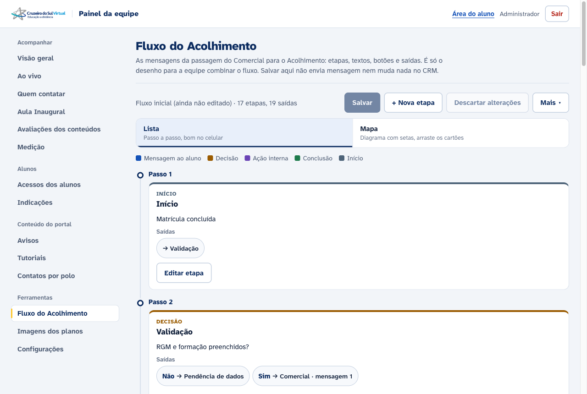

# Fluxo do Acolhimento (admin)

Atualizado em 10/11/2026. Aba **Ferramentas › Fluxo do Acolhimento** do painel da equipe (`/admin#fluxo`).

Mostra e deixa editar o desenho das mensagens da passagem do **Comercial para o Acolhimento**: etapas, textos, botões e saídas. É só o desenho, para a equipe combinar o fluxo antes de alguém montar a automação de verdade.

**Não tem regra nenhuma.** Salvar grava o desenho no banco do app e mais nada: não envia mensagem, não fala com o CRM, não chama o n8n. A régua que roda hoje continua sendo a de `docs/regua-calouro.md`.

## O que tem na tela



Mais prints em `docs/img/fluxo-acolhimento/`: caminhos lado a lado, mapa, editor e celular.

- **Lista** (`#fluxo`, padrão, boa no celular): o fluxo em passos, da esquerda para a direita do mapa. Cada passo mostra as etapas; quando há mais de um caminho (por exemplo, "Sim, agora", "Prefiro depois" e "Sem resposta"), elas aparecem lado a lado. Cada cartão traz:
  - tipo (cor) e título;
  - o texto: mensagens ao aluno aparecem como balão do WhatsApp, com `*negrito*`, `_itálico_` e as variáveis (`{{nome_atendente}}`) destacadas;
  - os botões da mensagem, quando houver;
  - as **saídas** (para onde o fluxo segue, com o rótulo da saída) e de onde a etapa vem. Tocar numa saída leva até a etapa.
- **Mapa** (`#fluxo/mapa`): o diagrama com setas, como no protótipo. Zoom de 50, 75 e 100%. Com "Arrastar cartões" ligado, arrastar muda o lugar do cartão (no teclado: foco no cartão e setas; Shift move mais). No celular começa desligado, para o dedo rolar o mapa em vez de arrastar cartão. O mapa rola dentro do quadro; a página não rola para o lado.
- **Editor** (toque em "Editar etapa" ou no cartão do mapa): título, tipo, texto com prévia, botões (até 3, 24 letras cada, como os botões de resposta do WhatsApp), saídas (rótulo e etapa de destino), "+ Etapa depois desta", duplicar e excluir. No computador abre ao lado; no celular, em tela cheia.
- **Barra**: Salvar, + Nova etapa, Descartar alterações e, em **Mais**: baixar o JSON, importar um JSON (por exemplo, o que o protótipo exportou) e voltar ao fluxo inicial.

As alterações ficam só na tela até tocar em **Salvar**. Sair da página com alteração não salva pede confirmação.

Tipos: Início, Mensagem ao aluno, Decisão, Ação interna e Conclusão (os mesmos do protótipo).

## De onde vem o conteúdo

O fluxo inicial é `server/dados/fluxo-acolhimento-inicial.json`, cópia sem mudança do `fluxo-acolhimento-dados.json` do protótipo "Fluxo editável · Comercial → Acolhimento" (17 etapas, 19 saídas). O teste confere que ele passa inteiro pela validação.

Enquanto ninguém salvou, a tela mostra esse inicial. "Voltar ao fluxo inicial" apaga a versão salva.

O protótipo trazia as opções do convite ("✅ Sim, agora", "🕒 Prefiro depois") dentro do texto. O campo de botões é novo e começa vazio; dá para levar as opções para botões no editor.

## Onde fica guardado

| | |
|---|---|
| Tabela | `csu_fluxo_acolhimento`: uma linha só (`id = 1`) com o fluxo em `fluxo JSONB`, `admin_id` (quem salvou) e `atualizado_em`. Sem linha = fluxo inicial. |
| Migração | `CREATE TABLE IF NOT EXISTS` em `server/fluxo-acolhimento.js` (`ensureSchema`), rodado na primeira chamada da rota, como as outras tabelas do app. |
| Rotas | `GET /api/admin/fluxo-acolhimento` e `PUT /api/admin/fluxo-acolhimento`, só com login de admin (`requireAdmin`). |
| Tela | `public/js/admin-fluxo.js`, `public/css/ds-fluxo.css` e o painel `#tab-fluxo` em `public/admin.html`. |

Por que uma linha com JSONB e não uma tabela por etapa: o fluxo é um desenho pequeno (cerca de 6 KB), editado inteiro e sem nenhuma regra lendo as etapas. Guardar o documento inteiro deixa a tela simples e o "voltar ao inicial" trivial. Se um dia o fluxo virar automação, as etapas vão para tabelas próprias.

### Formato

```json
{
  "nodes": [{ "id": "invite", "title": "…", "content": "…", "type": "message", "x": 1230, "y": 400, "buttons": ["Sim, agora"] }],
  "edges": [{ "from": "invite", "to": "choice", "label": "" }]
}
```

`x` e `y` são a posição no mapa. `buttons` só aparece quando a etapa tem botões.

### O que o servidor confere ao salvar (`normalizar`)

- `nodes` e `edges` precisam ser listas; pelo menos 1 e até 120 etapas, até 300 saídas.
- id de etapa: letras, números, `_` e `-`, até 48, sem repetir.
- Tipo fora da lista vira "Ação interna"; título vazio vira "Sem título".
- Cortes: título 120, texto 4000, rótulo de saída 60, botão 24 (até 3 botões).
- Saída que aponta para etapa que não existe, ou repetida, é descartada.
- Qualquer outro campo que vier do navegador é ignorado.
- O corpo do PUT pode ter até 300 KB (o resto da API aceita 20 KB).

### Duas pessoas editando

O PUT manda `base`, a data da versão que a tela carregou. Se outra pessoa salvou depois disso, o servidor responde **409** e não grava; a tela avisa e oferece recarregar (dá para baixar o JSON antes, para não perder o que fez).

## Testar

```bash
node tools/test-fluxo-acolhimento.js
```

Parte 1 sem banco (validação e o JSON inicial). Parte 2 com Postgres **local** descartável: cria um banco temporário, roda a migração duas vezes, salva, testa o 409, restaura e apaga o banco. Sem Postgres local, a parte 2 é pulada; `--sem-banco` pula de propósito.

Para ver a tela localmente, suba o servidor com um banco local vazio (`createdb`) e `ADMIN_EMAIL`/`ADMIN_PASSWORD` de teste, e abra `/admin.html#fluxo`.

## Reverter

Tirar o botão do menu em `public/admin.html` esconde a aba. A tabela `csu_fluxo_acolhimento` não é lida por mais nada; pode ficar ou ser apagada.
