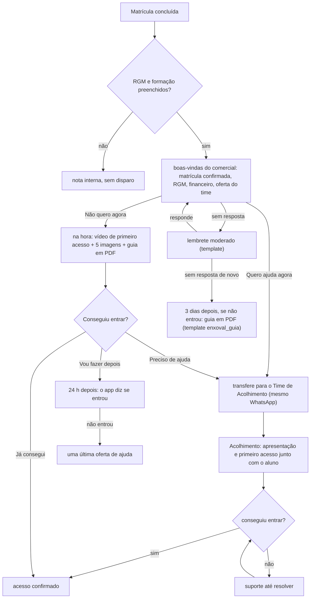

# Proposta: régua Comercial → Acolhimento, com o passo a passo para quem não quer atendimento

10/11/2026. Proposta, **nada ligado**. A régua atual (BV - Calouros, email_acad, Follow-up pós-link, `docs/regua-calouro.md`) continua como está. Esta régua nova seria uma automação separada, criada desligada e testada só no número do dono do projeto antes de qualquer aluno.

Base: o desenho que o comercial subiu, "Fluxo editável · Comercial → Acolhimento" (aba Fluxo do Acolhimento do admin, PR #18). A régua começa na matrícula: boas-vindas com o RGM e a oferta do time de ajudar. A proposta muda um ponto só:

- **Quero ajuda agora:** o Acolhimento atende e explica tudo, como no desenho.
- **Não quero agora:** o aluno recebe na hora o **passo a passo do primeiro acesso**: o vídeo de primeiro acesso (Kairo), as 5 imagens e o guia em PDF. No desenho original, esse caminho perguntava o melhor horário para um agendamento.

**Regra de texto:** com o aluno, nunca usar a palavra "enxoval". Falar do que ele recebe: "o passo a passo para entrar", "o guia", "o vídeo". "Enxoval" fica só como nome interno do material (`docs/enxoval.md`, pasta `public/enxoval/`).

## Fluxo

## Mensagens

### 1. Boas-vindas do comercial: um template só

O aluno ainda não escreveu, então a janela de 24 h está fechada e só sai **um template aprovado por vez**. As três mensagens do desenho (confirmação, financeiro e convite) viram um template único, `matricula_confirmada_comercial` (utilidade, a enviar à Meta):

> 🎓 *Sua matrícula está confirmada, {{1}}!*
>
> Parabéns por essa conquista! 💙 Seu RGM é {{2}}, e o seu acesso fica pronto em instantes.
>
> 💳 Para manter o maior desconto, pague a mensalidade até o dia 10 de cada mês. O valor final está no boleto.
>
> A partir de agora, o nosso Time de Acolhimento está aqui para te ajudar a entrar na plataforma e achar as suas aulas. *Quer ajuda agora?*

Botões: **Quero ajuda agora** · **Agora não**.

Pela Aula Inaugural, a mensalidade vence no dia 25 e o desconto é de 25% para quem paga até o dia 10. Se o comercial quiser citar o percentual, é preciso confirmar que ele vale para todas as matrículas.

### 2. "Quero ajuda agora"

> Combinado! 🙌 Já estou chamando o Time de Acolhimento. Em instantes uma pessoa fala com você aqui mesmo.

Em seguida: transferência interna, apresentação do atendente e checagem do primeiro acesso, como no desenho.

### 3. "Agora não": o passo a passo, na hora

O aluno acabou de tocar num botão, então a janela está aberta e tudo sai como mensagem comum, sem depender da Meta.

> Tudo bem! 😊 Para você entrar quando quiser, aqui está o passo a passo do seu primeiro acesso: um vídeo curto, 5 imagens e um guia para guardar.

Depois, nesta ordem, com 3 a 5 s entre as peças:

1. **vídeo de primeiro acesso** (Kairo). A legenda pode ser "Em menos de 1 minuto, o caminho completo para entrar."
2. **imagem 1, aplicativos**, com os links das lojas na legenda;
3. **imagem 2, primeira senha**, com o link para descobrir o e-mail acadêmico;
4. **imagem 3, entrar e achar as aulas**;
5. **texto:** "Agora, duas coisas importantes para o seu mês: a mensalidade e as disciplinas.";
6. **imagem 4, mensalidade**;
7. **imagem 5, disciplinas**;
8. **guia em PDF**, com a legenda "Este é o seu guia completo, para guardar.";
9. **pergunta:** "Conseguiu entrar?", com os botões **Já consegui** · **Preciso de ajuda** · **Vou fazer depois**.

As legendas das imagens estão em `docs/enxoval.md`.

### 4. Sem resposta às boas-vindas

- **Lembrete moderado, uma vez,** algumas horas depois, como no desenho ("limitar tentativas"). É um template curto que repete a oferta, com os mesmos dois botões.
- **Se continuar sem resposta,** 3 dias depois e só se ainda não entrou no app: template `enxoval_guia`, com o guia em PDF. Ele já está na Meta e o texto não usa a palavra "enxoval".

## Templates

| Template | Situação | Uso nesta régua |
|---|---|---|
| `matricula_confirmada_comercial` | a escrever com o comercial e enviar | boas-vindas |
| lembrete moderado | a escrever | sem resposta |
| `enxoval_guia` | na Meta, em análise | sem resposta, 3 dias |
| `enxoval_calouro` | na Meta, em análise | **não serve**: o texto fala "enxoval de calouro" e "Receber meu enxoval". Retirar da Meta. |

## Como as duas réguas convivem

- A régua atual dispara quando o negócio nasce no ACADÊMICO › Acolhimento. A nova dispara na matrícula concluída. As duas **não podem rodar para o mesmo aluno**, senão ele recebe duas boas-vindas.
- **Piloto:**
  1. Criar a automação nova desligada.
  2. Testar no número do dono do projeto.
  3. Ligar para uma parte dos negócios, por exemplo um polo, e tirar esses negócios do BV com uma condição no primeiro passo.
- **Comparar com o BV:**
  - quantos tocam nas boas-vindas;
  - quantos escolhem ajuda e quantos escolhem "Agora não";
  - quantos entram no app em 24 h e em 72 h;
  - quanto chega à fila de atendimento.

## Peças prontas

| Peça | Onde |
|---|---|
| 5 imagens e o guia em PDF | `public/enxoval/`, no ar desde 10/11 (rodapé "Seus primeiros passos") |
| 5 vídeos de primeiro acesso (Kairo, de 27 a 44 s, um por passo) | fora do repositório, em `~/Documents/enxoval-videos/`. Falta escolher se o aluno recebe os 5 ou um vídeo só, com os passos juntos |
| Checagem de primeiro acesso | `situacao_acesso_app` (Follow-up pós-link) |
