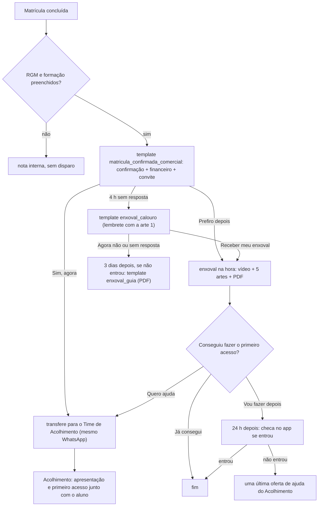

# Proposta: régua Comercial → Acolhimento, com enxoval para quem não quer atendimento

10/11/2026. Proposta, **nada ligado**. A régua atual (BV - Calouros, email_acad, Follow-up pós-link, `docs/regua-calouro.md`) continua como está. Esta régua nova seria uma automação separada, criada desligada e testada só no número do dono do projeto antes de qualquer aluno.

Base: o desenho "Fluxo editável · Comercial → Acolhimento" (aba Fluxo do Acolhimento do admin, PR #18). Muda só o que acontece quando o aluno **não quer** ser atendido agora: em vez de agendar, ele recebe o enxoval do calouro (`docs/enxoval.md`) e o vídeo de primeiro acesso.

## Diferença de tom

| | Régua atual (BV) | Régua do comercial |
|---|---|---|
| Quem fala | Atendimento ao Aluno, canal oficial | O comercial, que acabou de fechar a matrícula |
| Abertura | "seu primeiro acesso ainda não foi registrado" | "Sua matrícula está confirmada! Parabéns" |
| Pedido | Toque para receber o login | Convite para o Time de Acolhimento ajudar agora |
| Quem não quer ajuda | Lembrete e, em 24 h, uma pessoa | Recebe o enxoval e segue no ritmo dele |

## Ponto de atenção: uma mensagem só para abrir

No desenho, o comercial manda três mensagens seguidas: confirmação, orientação financeira e convite. Mas o aluno ainda não escreveu nada, então a janela de 24 h está fechada, e fora dela só sai **template aprovado, um por vez**. Por isso a proposta junta as três num template único, com os dois botões. Depois que o aluno toca num botão, a janela abre, e todo o resto sai como mensagem comum, sem depender da Meta.

## Fluxo

## Mensagens (tom do comercial)

### 1. Template `matricula_confirmada_comercial` (utilidade, a enviar à Meta)

> 🎓 *Sua matrícula está confirmada, {{1}}!*
>
> Parabéns por essa conquista! 💙 Seu RGM é {{2}}.
>
> 💳 Para manter o maior desconto, pague a mensalidade até o dia 10 de cada mês. O valor final está no boleto.
>
> Nosso Time de Acolhimento pode te mostrar agora, aqui mesmo no WhatsApp, como entrar na plataforma e achar as suas aulas. *Vamos começar?*

Botões: **Sim, agora** · **Prefiro depois**.

O texto financeiro segue a Aula Inaugural: a mensalidade vence no dia 25, e pagando até o dia 10 o desconto é de 25%. Se o comercial quiser citar o percentual, é preciso confirmar que ele vale para todas as matrículas.

### 2. "Sim, agora"

> Combinado! 🙌 Já estou chamando o Time de Acolhimento. Em instantes uma pessoa fala com você aqui mesmo.

Em seguida: transferência interna, apresentação e checagem do primeiro acesso, como no desenho do PR #18.

### 3. "Prefiro depois": o enxoval, na hora

> Sem problema! 😊 Preparamos o seu *enxoval de calouro* para você fazer no seu tempo: um vídeo curto, 5 imagens e um guia para guardar.

Depois, nesta ordem, com 3 a 5 s entre as peças:

1. vídeo de primeiro acesso (Kairo, em produção);
2. arte 1, aplicativos, com os links das lojas na legenda;
3. arte 2, primeira senha, com o link para descobrir o e-mail acadêmico;
4. arte 3, entrar e achar as aulas;
5. texto: "Agora, duas coisas importantes para o seu mês: a mensalidade e as disciplinas.";
6. arte 4, mensalidade;
7. arte 5, disciplinas;
8. PDF do guia do calouro;
9. pergunta final com botões: **Já consegui** · **Quero ajuda** · **Vou fazer depois**.

As legendas são as mesmas de `docs/enxoval.md`.

### 4. Sem resposta

- **4 h depois:** template `enxoval_calouro` (já enviado à Meta), com a arte 1 e os botões **Receber meu enxoval** · **Agora não**.
- **3 dias depois**, só se ainda não entrou: template `enxoval_guia` (já enviado), com o PDF.
- No máximo essas duas tentativas, como pede o desenho ("limitar tentativas").

## Como as duas réguas convivem

- A régua atual dispara quando o negócio nasce no ACADÊMICO › Acolhimento. A nova dispara na matrícula concluída, no comercial. As duas **não podem rodar para o mesmo aluno**, senão ele recebe duas boas-vindas.
- **Proposta de piloto:**
  1. Criar a automação nova desligada.
  2. Testar no número do dono do projeto.
  3. Depois, ligar para uma parte dos negócios, por exemplo um polo ou uma faixa de horário, e excluir esses negócios do BV com uma condição no primeiro passo.
- **Comparar com o BV:**
  - quantos tocam na primeira mensagem;
  - quantos entram no app em 24 h e em 72 h;
  - quantos pedem ajuda;
  - quanto chega à fila de atendimento.

## Dependências

| Item | Estado |
|---|---|
| Artes e PDF do enxoval | no ar (PR #17) |
| `enxoval_calouro`, `enxoval_guia` | enviados à Meta em 10/11, em análise |
| Vídeo de primeiro acesso | em produção no Kairo |
| `matricula_confirmada_comercial` | a escrever com o comercial e enviar à Meta |
| Gatilho "matrícula concluída" no comercial | a definir: hoje o n8n de criação do lead é chamado na venda |
| Checagem de primeiro acesso | pronta (`situacao_acesso_app`, Follow-up pós-link) |
