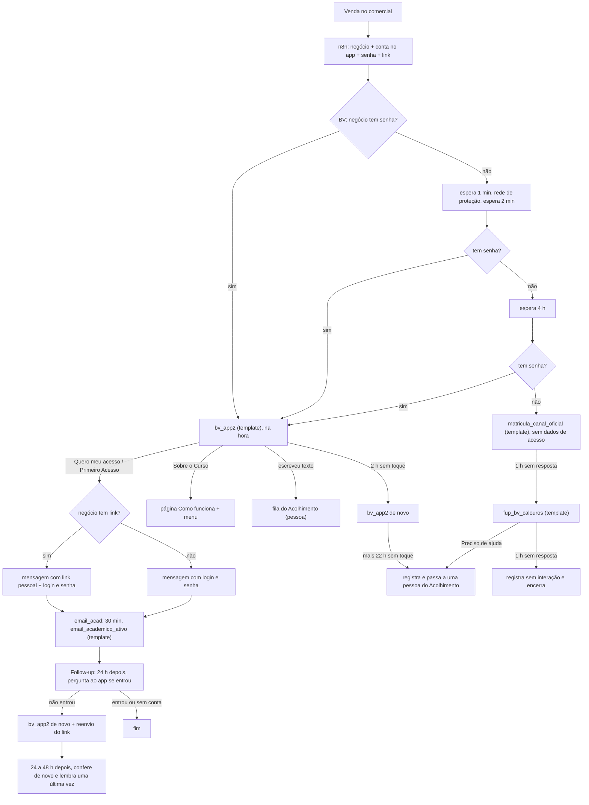

# Régua do calouro: da venda ao primeiro acesso

Atualizado em 07/11/2026, à tarde. Como o aluno novo recebe o acesso ao portal, o que dispara cada mensagem, quanto tempo leva, onde cada caminho termina e como operar e medir. Envolve três sistemas: o **CRM Bwipo** (automações e WhatsApp oficial), o **n8n** (integrações) e este **App do Aluno**.

Identificadores internos (ids de automação, de passo e de fluxo, endereços de webhook) não ficam aqui porque o repositório é público. Eles estão no manual de operação privado da equipe (página "Régua do calouro" no Claude), na seção "Operação".

## Peças

| Sistema | Peça | Papel |
|---|---|---|
| n8n | Criação do aluno (chamado pelo comercial na venda) | Cria contato e negócio no funil ACADÊMICO, etapa Acolhimento, com RGM, nível, senha inicial e link pessoal. Gera o link chamando o app. |
| n8n | Alunos provisórios | Cria a conta do aluno no app. |
| n8n | Rede de proteção da senha | Chamada pelo BV quando o negócio nasce sem senha: se for Graduação, grava a senha inicial e o link. |
| n8n | Checagem de acesso | Chamada pelo follow-up: pergunta ao app se o aluno entrou e grava a resposta no negócio. |
| n8n | Registro do BV | Recebe "Está tudo certo", "Preciso de ajuda" e "sem interação" e só grava numa tabela. |
| CRM | **BV - Calouros** | Disparada quando um negócio é criado no ACADÊMICO › Acolhimento. Manda o acesso. |
| CRM | **email_acad** | Chamada pelo BV depois do acesso. Manda o template do e-mail acadêmico e chama o follow-up. |
| CRM | **Follow-up pós-link** | 24 h depois, lembra quem recebeu o acesso e não entrou. |
| CRM | Aguardando Resposta, Encerramento | Fecham conversas sem resposta e tratam quem escreve depois de encerrado. |
| App | `POST /api/integracoes/link-acesso` | Gera o link pessoal (n8n). |
| App | `POST /api/auth/link` | Entrada pelo link (tela `/a/<token>`). |
| App | `POST /api/integracoes/situacao-acesso` | Diz se o aluno do RGM já entrou (n8n). |

## Fluxo



## Etapa por etapa

Template = mensagem aprovada pela Meta, chega mesmo fora da janela de 24 h. Mensagem livre = só chega dentro de 24 h da última mensagem do aluno; como o aluno acabou de tocar num botão, as mensagens livres abaixo ficam dentro da janela.

| Quando | O quê | Tipo | Saídas |
|---|---|---|---|
| Venda | Negócio criado com senha inicial (primeiro nome + `123@`) e link pessoal (`?o=bv_acesso`, vale 7 dias) | interno | Sem conta no app: negócio sem link, aluno recebe só login e senha. |
| 0 min | BV confere a senha | interno | Com senha: `bv_app2`. Sem senha: espera 1 min. |
| +1 e +3 min | Rede de proteção e nova conferência | interno | Pós-Graduação continua sem senha e espera 4 h. |
| +4 h | Sem senha: `matricula_canal_oficial` | template | Sobre o Curso; Primeiro Acesso (instruções do portal da faculdade e do app Duda, avisando que a senha de lá é diferente da senha do app); Chamo Depois. 1 h sem resposta: `fup_bv_calouros` (Está tudo certo: menu; Preciso de ajuda: pessoa do Acolhimento; 1 h sem resposta: registra e encerra). |
| Na hora | `bv_app2` ("toque em QUERO MEU ACESSO") | template | Quero meu acesso e Primeiro Acesso levam ao acesso. Sobre o Curso. Texto livre: fila do Acolhimento. 2 h sem toque: `bv_app2` de novo. Mais 22 h sem toque: registra no n8n, move o negócio para ATENDIMENTO › Em Atendimento e distribui para uma pessoa do Acolhimento (ela fala com o aluno por template ou ligação, porque a janela de 24 h não está aberta). |
| Ao tocar | Link pessoal ("Entre com um toque") com login e senha de reserva, ou só login e senha | livre | O BV passa o aluno para o email_acad e para ali. |
| Menu | "Conseguiu entender?" depois de cada explicação | livre | Sim: encerra. Preciso de ajuda: pessoa. Outro assunto: menu. 30 min sem resposta: encerra. O botão "Portal da faculdade" (antes "Acesso ao Portal") ensina o portal da faculdade, não o app. |
| +30 min | `email_academico_ativo` | template | O email_acad espera 1 min por resposta e chama o follow-up (respondendo ou não). Se o template falhar, o follow-up não começa. |
| +24 h | Follow-up pergunta ao app (via n8n) se o aluno entrou | interno | `entrou`, `sem_conta` ou `erro`: fim. `nao_entrou`: lembrete. |
| +24 h | `bv_app2` de novo | template | Quero meu acesso: reenvia o mesmo link (login `?o=bv_lembrete`) e convida para a Aula Inaugural. Sobre o Curso: Como funciona com botão "Quero meu acesso". Texto livre: fila do Acolhimento. |
| +48 a 72 h | Segunda conferência e último lembrete | template | Depois disso, fim. |

Em paralelo, no CRM:

- **Aguardando Resposta** (toda mensagem enviada): negócio em Acolhimento ou em Resolvendo não é afetado. Nas outras etapas, 1 h sem resposta encerra a conversa, move o negócio para a etapa do nível e tabula "Sem resposta".
- **Encerramento** (conversa tabulada): se o aluno escrever em até 5 min, oferece Voltar (vai para um consultor) ou Encerrar; depois move o negócio para a etapa do nível e tira o responsável.

## Templates

Todos de utilidade e aprovados em 07/11/2026: `bv_app2`, `matricula_canal_oficial`, `fup_bv_calouros`, `email_academico_ativo`, `certificado_aula_disponivel`, `certificado_aula_corrigido`. Enviados em 10/11/2026, aguardando a Meta: `enxoval_calouro` (imagem) e `enxoval_guia` (PDF), do enxoval do calouro. Se algum virar marketing, sai do WhatsApp de quem bloqueou marketing: a vigia confere.

## Campos do negócio usados

| Campo | Quem grava | Para quê |
|---|---|---|
| `rgm`, `nivel` | criação | Identificar o aluno e separar Graduação de Pós. |
| `senha_painel_eduit` | criação ou rede de proteção | Senha inicial nas mensagens. |
| `link_acesso` | criação, rede de proteção ou lote avulso | Link pessoal nas mensagens. |
| `situacao_acesso_app` | checagem de acesso | `entrou`, `nao_entrou`, `sem_conta` ou `erro`; decide o lembrete. |

## App

### Link pessoal (`server/link-acesso.js`)

- `POST /api/integracoes/link-acesso` com `{ rgm, origem }` e cabeçalho `X-Segredo` (`LINK_ACESSO_SEGREDO`). Responde `{ url, expira_em }`. Sem segredo configurado: 503. Segredo errado: 401. RGM sem conta ativa: 404.
- O token tem 32 bytes aleatórios; o banco guarda só o sha256 (`csu_links_acesso`). Um link novo para o mesmo aluno cancela os anteriores, inclusive os usados.
- Vale `LINK_ACESSO_DIAS` dias (padrão 7). Na primeira entrada o aparelho recebe o cookie `csu_link` (HttpOnly, só no caminho `/api/auth/link`; o banco guarda o sha256 em `aparelho_hash`). Tocar de novo no mesmo aparelho entra de novo, até 30 vezes (`reusos`), registrado com `via = link_de_novo`. Em outro aparelho: "Este link já foi usado em outro aparelho", com o RGM preenchido e o cursor na senha.
- Vencido: "Este link venceu". Inválido: tela de login.

### Situação de acesso

`POST /api/integracoes/situacao-acesso` com `{ rgm }` e o mesmo `X-Segredo`. Responde:

```json
{ "success": true, "situacao": "nao_entrou", "primeira_entrada_em": null,
  "link": { "gerado_em": "...", "usado": false, "vencido": false } }
```

`entrou` = já fez login por qualquer caminho (`csu_alunos.primeiro_login_em`). Não devolve nome, e-mail nem telefone.

### Senha própria

A troca de senha no primeiro acesso existe (`server/senha.js`), mas está desligada: `TROCA_SENHA_PARA` vazio. Os textos do login e da página Como funciona dizem "Se o app pedir, crie uma senha só sua", que vale ligada ou desligada.

### Origens (`?o=`)

| Origem | De onde vem |
|---|---|
| `bv_acesso` | link pessoal mandado pelo BV, pela rede de proteção, pelo lote avulso e pelo follow-up |
| `bv` | link do login na mensagem sem link pessoal |
| `bv_lembrete` | link do login no reenvio do follow-up |
| `bv_curso` | página Como funciona a partir do botão Sobre o Curso |
| `cert`, `cert_erro` | avisos de certificado de 06/11/2026 |
| `guia_pdf` | link do app no guia em PDF do enxoval do calouro (`docs/enxoval.md`) |

### Admin

Quem contatar: a busca por RGM, nome ou e-mail procura em todos os alunos, ignorando Mostrar, Etapa e datas, e abre o percurso quando acha um só (PR #12, publicado em 07/11). Medição: entradas por origem e falhas de login por motivo (`docs/instrumentacao.md`).

## Como medir

- **Toque no botão**: dos negócios que entraram depois das mudanças de 06/11, 83% tocaram em "Quero meu acesso" (19 de 23); antes eram 75% (202 de 268), metade em até 6 min.
- **Proteção da senha**: nenhum template de matrícula para Graduação desde que entrou no ar; nos 4 dias anteriores foram 27.
- **E-mail acadêmico**: 30 min depois do acesso (182 envios medidos).
- **Funil dos novos desde 04/11** (06/11, 20h45): 216 contas, 127 entraram (59%), 76 começaram a Aula, 38 concluíram, 22 com certificado.
- A cada 2 h, a vigia confere execuções, falhas e templates; o roteiro está no manual de operação.

## Testar e reverter

- `DATABASE_URL=postgres://localhost:5432/<banco descartável> node tools/test-link-acesso.js`: gera o link, primeira entrada, mesmo aparelho, outro aparelho, link novo cancela o antigo, vencido, inválido e a situação de acesso. Recusa banco que não seja local.
- Toda automação do CRM alterada tem uma cópia desligada feita antes da mudança. Para voltar, desligue a atual e ligue a cópia (ou copie os passos de volta). A lista das cópias está no manual de operação.
- Para parar só o follow-up: desligue a automação "Follow-up pós-link". O email_acad continua mandando o template; a transferência falha sem afetar o aluno.

## Pontos em aberto (07/11/2026)

1. A espera do CRM pelo botão nem sempre dispara: de 19 alunos que não tocaram em nada (03 a 05/11), 7 não receberam o lembrete. Acompanhar com a cadência nova de 2 h.
2. Alunos que pediram o acesso antes de 07/11 e não entraram ficam fora do follow-up; os links deles vencem em 14/11.
3. Não há follow-up para quem entrou e não começou a Aula Inaugural.
4. Atendimento por pessoas: 189 conversas esperando e 169 com SLA crítico em 07/11 de manhã. A cadência nova manda para lá quem não toca em 24 h.

Para quem não quer entrar agora ou não responde, há o enxoval do calouro: 5 artes e um guia em PDF mandados pelo WhatsApp, com templates em rascunho (`docs/enxoval.md`), ainda sem gatilho ligado.

O fluxo antigo de ativação no n8n que usa o Kommo está fora desta régua: o Kommo não é mais usado.

## Histórico

| Data | Mudança |
|---|---|
| 06/11 | Link pessoal no BV e página Como funciona (`fe3fc80`). Rede de proteção da senha para Graduação. email_acad passa ao template de utilidade. 31 avisos de certificado e 14 acessos reenviados. |
| 06/11 | Link reaberto no mesmo aparelho (PR #10). |
| 07/11 | Link pessoal gravado em 146 negócios de Graduação de 30/10 a 06/11 que estavam sem link. |
| 07/11 | Texto da mensagem do link ("vale por 7 dias no celular em que você abrir primeiro"). Login e Como funciona sem prometer senha nova (PR #11). |
| 07/11 | Situação de acesso no app (PR #13) e Follow-up pós-link ligado. |
| 07/11 | email_acad: o template esperava resposta por 24 h e, sem resposta, pulava a chamada do follow-up; agora espera 1 min e segue. Quem recebeu o e-mail antes da correção entra no follow-up quando a espera antiga de 24 h vencer. |
| 07/11 | Cadência de quem não toca: lembrete em 2 h (antes 24 h) e pessoa em 24 h (antes encerrava em 48 h). "Conseguiu entender?" espera 30 min (antes 1 min). "Preciso de ajuda" do `fup_bv_calouros` chama uma pessoa. Textos do portal da faculdade separam a senha de lá da senha do app. |
| 10/11 | Enxoval do calouro: 5 artes, guia em PDF e rascunho de dois templates; nenhum gatilho ligado. |
